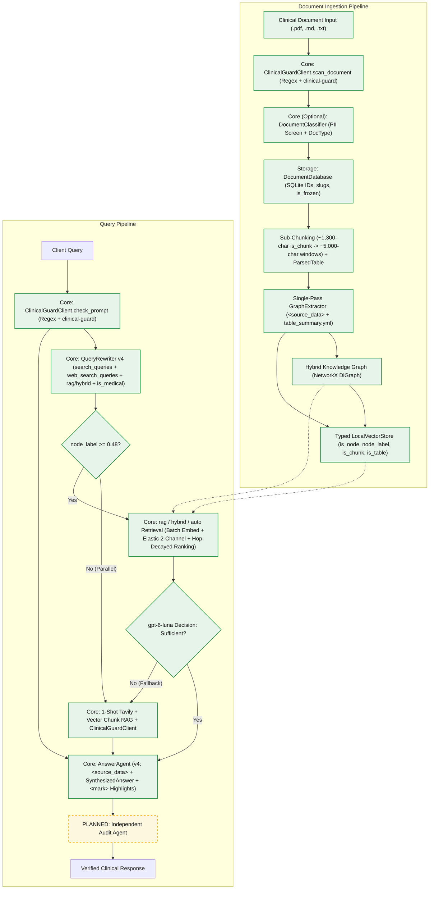

# clinical-graph Architecture

`clinical-graph` is a FastAPI microservice for hybrid knowledge-graph and vector-backed clinical retrieval, document ingestion, and grounded answer synthesis.

## Pipelines Overview

The architecture separates **Core (Implemented)** components from **Optional / Planned (Phase 2)** safety, search, and verification layers.

### Scope Legend

- **Core (Implemented)**:
  - **Prompt-Injection Guardrails (`guardrails/`)**: `ClinicalGuardClient` and `scan_text_for_injection` screen document uploads (`scan_document` with `1,200`-char / `150`-overlap windows and `Semaphore(2)`) and incoming queries (`check_prompt` via `POST /v1/guard/prompt`), running local regex rules first, forwarding `X-Forwarded-For`, retrying `429`/`503` with `Retry-After` backoff, and polling `GET /health`.
  - **Document Ingestion Pipeline**: Parses `.pdf` (`fitz` text + `ParsedTable` with surrounding page context), `.md`, and `.txt` documents; splits cleaned text into `~1,300`-char `is_chunk` retrieval chunks grouped into `~5,000`-char extraction windows; summarizes tables via `table_summary.yml` (`is_table`); wraps extraction windows in `<source_data>` delimiters for single-pass `graph_extraction.yml` (`relationship_description`, `relationship_strength`, verbatim `quote`, `chunk_id` mapping, self-loop rejection, `max(weight)` edge merging); and persists entities/relations in a `networkx.DiGraph` plus typed `LocalVectorStore` (`is_node`, `is_chunk`, `is_table` with `delete_by_doc_id` cleanup, `is_frozen` showcase protection, and `AUTO_PRUNE_NON_FROZEN_HOURS` 24h showcase auto-cleanup).
  - **DocumentClassifier (Optional)**: Activated via `classify=true` to run deterministic PII/PHI regex screening and LLM `DocType` allowlist classification before persistence.
  - **Hybrid Retrieval (`rag` / `hybrid` / `auto`)**: `QueryRewriter` (`v4`) expands conversational queries into standalone search queries, enforces `is_medical` query gating, and routes `auto` requests to `rag` or `hybrid`. `QueryPipeline` embeds `search_queries` in a single batch (`embed_queries`) reused across `is_chunk`, `is_table`, and `is_node` searches, traverses $k$ hops with hop-tagged `traverse_k_hops`, ranks edges via hop-decayed IDF-BM25 + bridge-bonus + hub-damped scoring, and assembles chunks via an elastic two-channel strategy (`chunk_sources`: `rag`, `graph`, `both`).
  - **Answer Agent (`v4`)**: Wraps retrieved passages and tables in `<source_data>` delimiters and synthesizes strictly grounded responses (`SynthesizedAnswer` with `CitationQuote(ref_id, quote)`), resolving each quote into a `CitationPassage` with `chunk_id` and `<mark>` highlights.
  - **Benchmarks & 2-View Web UI**: `GET /v1/benchmarks` serves compact retrieval benchmark telemetry (`eval/results/eval_*.json`) to the static 2-view frontend (`Overview` + `Workspace`).
- **Optional / Planned (Phase 2)** *(dashed amber nodes in diagram; detailed in [Optional Improvements](#optional-improvements))*: External fallback search and secondary verification layers (Verified Internet Search + Source Auditor, and Independent Audit Agent).

## Module Map (`src/clinical_graph/`)

| Module | Status | Responsibility |
| --- | --- | --- |
| `main.py` | Core | FastAPI app factory (`create_app`), `lifespan` management, `/health` endpoint, static frontend mount, `uvicorn` entrypoint |
| `config.py` | Core | Pydantic v2 `Settings` (`BaseSettings`) for runtime configuration, `clinical-guard` URL/timeout, and feature flags |
| `api/` | Core | FastAPI route definitions (`routes_documents.py`, `routes_query.py`, `routes_graph.py` including `GET /v1/benchmarks` & `/v1/system/status`), rate limiting, and dependency wiring (`deps.py`) |
| `schemas/` | Core | Pydantic v2 request/response, document (`is_frozen`), metrics, and citation models |
| `parser/` | Core | `DocumentParser` (`ParsedDocument`, `ParsedTable`), `strip_references_and_boilerplate`, and `chunker.py` (`chunk_text_with_spans`, `group_chunks_for_extraction`) |
| `graph/` | Core | Consolidated graph & storage layer: `DocumentDatabase` (SQLite), `ClinicalKnowledgeGraph` (`NetworkX DiGraph`), typed `LocalVectorStore` (`is_node`, `is_chunk`, `is_table`), and `KnowledgeManager` |
| `pipelines/` | Core | Framework-agnostic `IngestionPipeline` and `QueryPipeline` orchestrating parsing, extraction, retrieval, and synthesis |
| `prompts/` | Core | Versioned YAML prompt templates (`loader.py`) for extraction, table summary, classification, query rewrite (`v4`), and answer synthesis (`v4`) |
| `llm/` | Core | `LiteLLMClient` async wrapper for provider-agnostic model routing and token/cost telemetry |
| `agents/` | Core / Optional | Core `AnswerAgent` (`v4`), `QueryRewriter` (`v4`), single-pass `GraphExtractor`, `DocumentClassifier`, and optional Independent Audit Agent (not yet implemented) |
| `guardrails/` | Core | `ClinicalGuardClient` + `scan_text_for_injection` regex-first & `clinical-guard` prompt/document screening (`POST /v1/guard/prompt`, `GET /health`, `Semaphore(2)`, `Retry-After`) |
| `search/` | Core (Optional Flag) | Verified 1-shot Tavily web fallback (`enable_web_fallback`), `gpt-6-luna` Decisions trigger, temporary vector-chunk RAG, and `< 1 ms` local regex + `<source_data>` delimiting (see [web_search.md](web_search.md)) |

## Optional Improvements

- **Verified Internet Search + Source Auditor**: External fallback retrieval with temporary vector-chunk RAG when local graph/vector context is insufficient, controlled via `enable_web_fallback` and an explicit UI confirmation modal.
- **Independent Audit Agent**: Secondary verification pass over generated answers, controlled via `enable_audit_agent`.
- **LangFuse Observability**: Enable end-to-end LLM trace, prompt, latency, and cost observability via LiteLLM callbacks (`litellm.success_callback = ["langfuse"]`) with `LANGFUSE_PUBLIC_KEY` and `LANGFUSE_SECRET_KEY` configured in `.env`.
- **Image & Figure Parsing via VLM**: Extend `DocumentParser` to render embedded PDF figures and charts with `fitz` (`page.get_pixmap()` / image extraction) and generate structured clinical captions or table extractions using a Vision-Language Model (VLM).
- **Lightweight NER Pre-Filter**: Run a fast local NER model (e.g., spaCy / scispaCy or GLiNER) prior to LLM graph extraction and PII screening to pre-tag biomedical entities and catch residual PHI before calling external LLM APIs.
- **Language-Agnostic TOC-Based Section Omission**: Extract the embedded PDF Table of Contents via `fitz` (`doc.get_toc()`, yielding `[level, title, page_number]`) and pass it inside `DocumentClassifier` so the LLM can identify non-clinical boilerplate and reference sections across any language, falling back to the deterministic EN/DE `strip_references_and_boilerplate` cleaner when no TOC is present.
- **External Persistent Vector Store**: Swap `LocalVectorStore` (in-memory NumPy) for ChromaDB, Qdrant, or LanceDB behind the `Embedder` / vector store boundary if corpus or entity counts outgrow single-worker memory.
