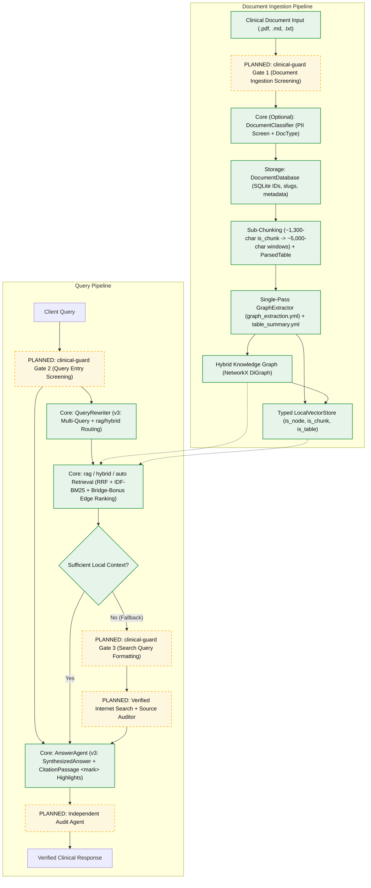

# clinical-graph Architecture

`clinical-graph` is a FastAPI microservice for hybrid knowledge-graph and vector-backed clinical retrieval, document ingestion, and grounded answer synthesis.

## Pipelines Overview

The architecture separates **Core (Implemented)** components from **Planned (Phase 2)** safety, search, and verification layers.

### Scope Legend

- **Core (Implemented)**:
  - **Document Ingestion Pipeline**: Parses `.pdf` (`fitz` text + `ParsedTable` with surrounding page context), `.md`, and `.txt` documents; splits cleaned text into `~1,300`-char `is_chunk` retrieval chunks grouped into `~5,000`-char extraction windows; summarizes tables via `table_summary.yml` (`is_table`); runs single-pass `graph_extraction.yml` (`relationship_description`, `relationship_strength`, verbatim `quote`, `chunk_id` mapping, self-loop rejection, `max(weight)` edge merging); and persists entities/relations in a `networkx.DiGraph` plus typed `LocalVectorStore` (`is_node`, `is_chunk`, `is_table` with `delete_by_doc_id` cleanup).
  - **DocumentClassifier (Optional)**: Activated via `classify=true` to run deterministic PII/PHI regex screening and LLM `DocType` allowlist classification before persistence.
  - **Hybrid Retrieval (`rag` / `hybrid` / `auto`)**: `QueryRewriter` (`v3`) expands conversational queries into standalone search queries and routes `auto` requests to `rag` (direct `is_chunk` + `is_table` search fused with Reciprocal Rank Fusion) or `hybrid` (parallel `is_chunk`/`is_table` search and `is_node` seed search + $k$-hop `DiGraph` traversal with IDF-weighted BM25, bridge-bonus, and hub-damped edge ranking, fused via RRF).
  - **Answer Agent (`v3`)**: Synthesizes strictly grounded responses (`SynthesizedAnswer` with `CitationQuote(ref_id, quote)`) from matched concepts, ranked graph edges, retrieved chunks/tables, and supporting document metadata, resolving each quote into a `CitationPassage` with `chunk_id` and `<mark>` highlights.
- **Planned (Phase 2)**:
  - **clinical-guard (3-Gate Middleware)**: Document ingestion screening (Gate 1), query entry screening (Gate 2), and search query formatting (Gate 3), controlled via `enable_guardrails`.
  - **Verified Internet Search + Source Auditor**: External fallback retrieval with source credibility auditing when local graph/vector context is insufficient, controlled via `enable_web_fallback`.
  - **Independent Audit Agent**: Secondary verification pass over generated answers, controlled via `enable_audit_agent`.

## Module Map (`src/clinical_graph/`)

| Module | Status | Responsibility |
| --- | --- | --- |
| `main.py` | Core | FastAPI app factory (`create_app`), `lifespan` management, `/health` endpoint, `uvicorn` entrypoint |
| `config.py` | Core | Pydantic v2 `Settings` (`BaseSettings`) for runtime configuration and feature flags |
| `api/` | Core | FastAPI route definitions (`routes_documents.py`, `routes_query.py`) and dependency wiring (`deps.py`) |
| `schemas/` | Core | Pydantic v2 request/response, document, metrics, and citation models |
| `parser/` | Core | `DocumentParser` (`ParsedDocument`, `ParsedTable`), `strip_references_and_boilerplate`, and `chunker.py` (`chunk_text_with_spans`, `group_chunks_for_extraction`) |
| `graph/` | Core | Consolidated graph & storage layer: `DocumentDatabase` (SQLite), `ClinicalKnowledgeGraph` (`NetworkX DiGraph`), typed `LocalVectorStore` (`is_node`, `is_chunk`, `is_table`), and `KnowledgeManager` |
| `pipelines/` | Core | Framework-agnostic `IngestionPipeline` and `QueryPipeline` orchestrating parsing, extraction, retrieval, and synthesis |
| `prompts/` | Core | Versioned YAML prompt templates (`loader.py`) for extraction, table summary, classification, query rewrite, and answer synthesis |
| `llm/` | Core | `LiteLLMClient` async wrapper for provider-agnostic model routing and token/cost telemetry |
| `agents/` | Core / Planned | Core `AnswerAgent` (`v3`), `QueryRewriter` (`v3`), single-pass `GraphExtractor`, `DocumentClassifier`, and planned Independent Audit Agent |
| `guardrails/` | Planned | `clinical-guard` 3-gate middleware (not yet implemented) |
| `search/` | Planned | Verified internet search fallback and Source Auditor (not yet implemented) |

## Optional Improvements

- **LangFuse Observability**: Enable end-to-end LLM trace, prompt, latency, and cost observability via LiteLLM callbacks (`litellm.success_callback = ["langfuse"]`) with `LANGFUSE_PUBLIC_KEY` and `LANGFUSE_SECRET_KEY` configured in `.env`.
- **Image & Figure Parsing via VLM**: Extend `DocumentParser` to render embedded PDF figures and charts with `fitz` (`page.get_pixmap()` / image extraction) and generate structured clinical captions or table extractions using a Vision-Language Model (VLM).
- **Lightweight NER Pre-Filter**: Run a fast local NER model (e.g., spaCy / scispaCy or GLiNER) prior to LLM graph extraction and PII screening to pre-tag biomedical entities and catch residual PHI before calling external LLM APIs.
- **Language-Agnostic TOC-Based Section Omission**: Extract the embedded PDF Table of Contents via `fitz` (`doc.get_toc()`, yielding `[level, title, page_number]`) and pass it inside `DocumentClassifier` so the LLM can identify non-clinical boilerplate and reference sections across any language, falling back to the deterministic EN/DE `strip_references_and_boilerplate` cleaner when no TOC is present.
- **External Persistent Vector Store**: Swap `LocalVectorStore` (in-memory NumPy) for ChromaDB, Qdrant, or LanceDB behind the `Embedder` / vector store boundary if corpus or entity counts outgrow single-worker memory.
