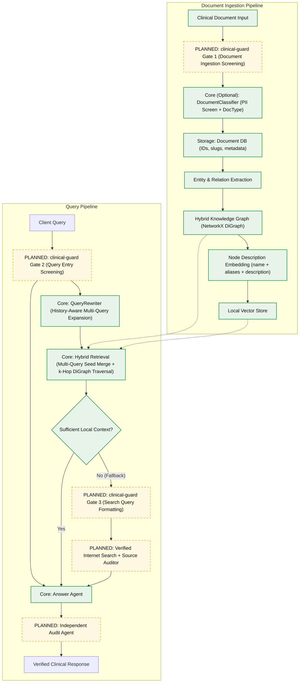

# clinical-graph Architecture

`clinical-graph` is a FastAPI microservice for hybrid knowledge-graph and vector-backed clinical retrieval, document ingestion, and grounded answer synthesis.

## Pipelines Overview

The architecture separates **Core (Initial Scope)** components from **Planned (Future Phases)** safety, search, and verification layers.

### Scope Legend

- **Core (Initial Scope)**:
  - **Document Ingestion Pipeline**: Persists document IDs, slugs, and metadata; extracts clinical entities/relations into a `networkx.DiGraph`; embeds node descriptions (`name + aliases + description`) in a local vector store.
  - **DocumentClassifier (Optional)**: Activated via the `classify=true` API parameter to run deterministic PII/PHI regex screening and LLM `DocType` allowlist classification before persistence.
  - **Hybrid Retrieval**: Expands conversational queries via `QueryRewriter` into standalone search queries with `focused`/`multi_hop` routing, merges multi-query node vector search results by max similarity score, runs $k$-hop (`1` for `focused`, `graph_k_hops` for `multi_hop`) directed graph neighborhood traversal, ranks edges by incident seed score and query token overlap, and extracts `±200`-char chunk-scoped supporting passages (with paragraph-BM25 fallback).
  - **Answer Agent**: Synthesizes grounded responses from seed node descriptions, up to `25` ranked graph edges with unique excerpts, `±200`-char supporting passages, and supporting document metadata.
- **Planned (Future Phases)**:
  - **clinical-guard (3-Gate Middleware)**: Document ingestion screening (Gate 1), query entry screening (Gate 2), and search query formatting (Gate 3), controlled via `enable_guardrails`.
  - **Verified Internet Search + Source Auditor**: External fallback retrieval with source credibility auditing when local graph/vector context is insufficient, controlled via `enable_web_fallback`.
  - **Independent Audit Agent**: Secondary verification pass over generated answers, controlled via `enable_audit_agent`.

## Module Map (`src/clinical_graph/`)

| Module | Status | Responsibility |
| --- | --- | --- |
| `main.py` | Core | FastAPI app factory (`create_app`), `lifespan` management, `/health` endpoint, `uvicorn` entrypoint |
| `config.py` | Core | Pydantic v2 `Settings` (`BaseSettings`) for runtime configuration and feature flags |
| `api/` | Core | FastAPI route definitions and dependency wiring |
| `schemas/` | Core | Pydantic v2 request/response and domain models |
| `parser/` | Core | `DocumentParser` and `ParsedDocument` for `.pdf` (`fitz`), `.md`, and `.txt` extraction |
| `graph/` | Core | Consolidated graph & storage layer: `DocumentDatabase` (SQLite), `ClinicalKnowledgeGraph` (`NetworkX DiGraph`), `LocalVectorStore`, and `KnowledgeManager` |
| `llm/` | Core | `LiteLLMClient` async wrapper for provider-agnostic model routing |
| `agents/` | Core / Planned | Core `AnswerAgent`, `QueryRewriter`, two-stage `GraphExtractor`, and planned independent Audit Agent |
| `guardrails/` | Planned | `clinical-guard` 3-gate middleware (not yet implemented) |
| `search/` | Planned | Verified internet search fallback and Source Auditor (not yet implemented) |

## Optional Improvements

- **LangFuse Observability**: Enable end-to-end LLM trace, prompt, latency, and cost observability via LiteLLM callbacks (`litellm.success_callback = ["langfuse"]`) with `LANGFUSE_PUBLIC_KEY` and `LANGFUSE_SECRET_KEY` configured in `.env`.
- **Image & Figure Parsing via VLM**: Extend `DocumentParser` to render embedded PDF figures and charts with `fitz` (`page.get_pixmap()` / image extraction) and generate structured clinical captions or table extractions using a Vision-Language Model (VLM).
- **Lightweight NER Pre-Filter**: Run a fast local NER model (e.g., spaCy / scispaCy or GLiNER) prior to LLM graph extraction and PII screening to pre-tag biomedical entities and catch residual PHI before calling external LLM APIs.
- **External Persistent Vector Store**: Swap `LocalVectorStore` (in-memory NumPy) for ChromaDB, Qdrant, or LanceDB behind the `Embedder` / vector store boundary if canonical entity node counts outgrow single-worker memory.
- **Language-Agnostic TOC-Based Section Omission**: Extract the embedded PDF Table of Contents via `fitz` (`doc.get_toc()`, yielding `[level, title, page_number]`) and pass it inside `DocumentClassifier` so the LLM can identify non-clinical boilerplate and reference sections across any language, falling back to the deterministic EN/DE `strip_references_and_boilerplate` cleaner when no TOC is present.

## Planned Changes

Upcoming unified hybrid GraphRAG upgrade:

1. **Typed `LocalVectorStore` (`is_node`, `is_chunk`, `is_table`)**:
   - Store `~1,300`-char retrieval chunks (`is_chunk`), LLM-summarized tables with surrounding page context (`is_table` pointing to raw Markdown tables), and canonical entity descriptions (`is_node`) in `LocalVectorStore`, with tight `delete_document()` cleanup across all three entry types.
2. **Sub-Chunking & Single-Pass GraphRAG Extraction**:
   - Group `~1,300`-char `is_chunk` retrieval chunks into `~5,000`-char extraction windows, run single-pass `{nodes, edges}` extraction (Microsoft GraphRAG-aligned `relationship_description` + `relationship_strength` `1–10` + verbatim `quote`), map each edge quote to its exact `~1,300`-char `chunk_id`, reject self-loops (`u == v`), and merge double edges using `max(weight)` + `evidence` provenance count.
3. **`rag` / `hybrid` / `auto` Retrieval with RRF**:
   - **`rag` mode**: Search `is_chunk` + `is_table` directly across `search_queries` and fuse with Reciprocal Rank Fusion (RRF).
   - **`hybrid` mode**: Run `is_chunk`/`is_table` search (`k=5`) in parallel with `is_node` search (`k=5`) + `k`-hop `DiGraph` traversal (with hub-degree damping), deduplicate chunks by `chunk_id`, rank via RRF, and pass **Matched concepts + Ranked relationships + Ranked chunks/tables** to `AnswerAgent`.
   - **`auto` mode**: `QueryRewriter` routes focused/dosing queries to `rag` and multi-hop relational queries to `hybrid`.
4. **Strict No-Pretraining Grounding & Citations**:
   - Tighten `answer_synthesis.yml` (`v2`) to forbid pretraining knowledge, and localize `Citation` excerpts via `chunk_id` + BM25.
