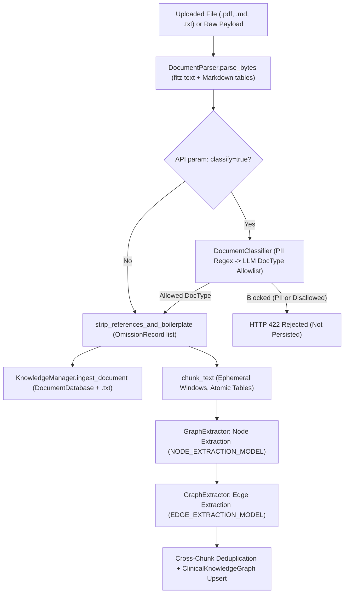

# Document Parsing

The `clinical_graph.parser` package normalizes uploaded or on-disk clinical documents into structured text and Markdown tables prior to ingestion into `KnowledgeManager`.

## Parsing & Ingestion Workflow

Classification is controlled by the optional `classify` API parameter (`?classify=true` query parameter on `POST /v1/documents` or `classify=true` form field on `POST /v1/documents/upload`).

## Supported Formats

| Extension | `SourceType` | Extraction Backend | Notes |
| --- | --- | --- | --- |
| `.pdf` | `uploaded_pdf` | PyMuPDF (`fitz`) | Extracts per-page plain text (`page.get_text("text")`) and structured tables (`page.find_tables()` formatted as GitHub-flavored Markdown). |
| `.md` | `markdown` | UTF-8 decoder | Preserves raw Markdown text. |
| `.txt` | `raw_text` | UTF-8 decoder | Preserves plain text. |

Any other file extension raises a `ValueError` (mapped to HTTP `400 Bad Request` on `POST /v1/documents/upload`).

## Explicit Scope & Limitations

- **Text and tables only**: `DocumentParser` extracts **only text and tables** from supported documents.
- **Images and figures are omitted**: Embedded images, charts, diagrams, and scanned figures in PDFs are **intentionally omitted** at this time due to processing complexity and memory constraints.
- **Future VLM extension**: Image and figure understanding can be added in a future phase via a **Vision-Language Model (VLM)** pipeline (e.g., rendering pages or extracted figure regions and generating structured clinical captions/descriptions).

## Cleaning & Ephemeral Chunking

### Reference & Boilerplate Omission (`strip_references_and_boilerplate`)
- `src/clinical_graph/parser/cleaner.py` strips bibliography/reference sections, citation-dense trailing blocks, and repeated page headers/footers before extraction, while preserving clinical appendices (such as dosing tables).
- Each omitted span is captured as an `OmissionRecord` (`reason`, `heading`, `char_count`, `preview`) and saved on `DocumentRecord.omissions`.

### Ephemeral Extraction Chunks (`chunk_text` & `chunk_text_with_spans`)
- `src/clinical_graph/parser/chunker.py` splits cleaned text along Markdown headings and paragraph boundaries (keeping Markdown tables intact as atomic blocks) with configurable `max_chars` and `overlap_paragraphs`.
- `chunk_text_with_spans` returns `(chunk_str, start_char, end_char)` offsets into the cleaned text, while `chunk_text` delegates to it.
- Chunks are **ephemeral extraction windows** used by `GraphExtractor` (`extract_nodes` + `extract_edges`) and are **not** embedded as document chunks in `LocalVectorStore`.
- Deterministic `{doc_id}:chunk:{i}` identifiers are saved on `DocumentRecord.chunk_ids`, and `ChunkSpan(chunk_id, start_char, end_char)` records are persisted on `DocumentRecord.chunk_spans` for edge provenance and query-time `±200`-char passage expansion.

## API & Usage

### `DocumentParser` (`src/clinical_graph/parser/document_parser.py`)

- `parse_bytes(data: bytes, filename: str) -> ParsedDocument`
- `parse_file(path: str | Path) -> ParsedDocument`

`ParsedDocument` returns:
- `text: str` — extracted document text (pages joined by `\n\n` for PDFs).
- `tables: list[str]` — Markdown-formatted tables extracted from PDF pages.
- `page_count: int | None` — total PDF page count (`None` for `.md` and `.txt`).
- `source_type: SourceType` — normalized origin format.

### HTTP Upload Endpoint

`POST /v1/documents/upload` accepts `multipart/form-data` with:
- `file`: uploaded `.pdf`, `.md`, or `.txt` file
- `title`: document title
- `doc_type`: optional `DocType` enum value (when omitted and `classify=true`, auto-populated from `DocumentClassifier.predicted_doc_type`; defaults to `guideline` when `classify=false`)
- `local_restriction`: `LocalRestriction` enum value (defaults to `none`)
- `description`: optional summary
- `classify`: optional boolean API parameter (`classify=true` form field; or `?classify=true` query parameter on `POST /v1/documents`) to run `DocumentClassifier` before ingestion
- `extract`: optional boolean form field (`extract=true`) to run `GraphExtractor` during ingestion
