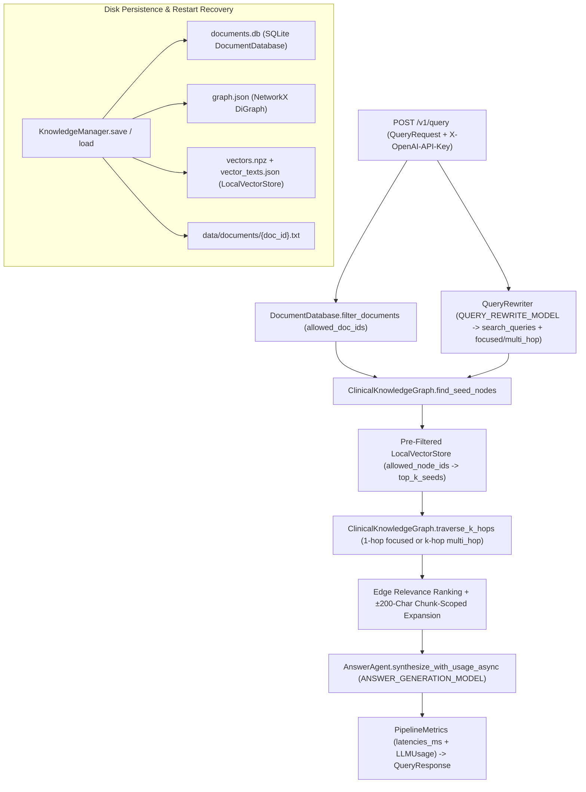

# GraphRAG & Document Handling Design

This document describes the hybrid GraphRAG pipeline, two-stage LiteLLM extraction and synthesis, clinical document lifecycle, and vector store tradeoffs in `clinical-graph`.

## GraphRAG Query & Persistence Workflow



## 1. Hybrid GraphRAG Pipeline

`clinical-graph` combines a directed property graph (`networkx.DiGraph`) with node-level vector embeddings and faceted document metadata filtering.

### Node-Description Embeddings
- Rather than chunking documents into opaque fixed-size passages, each clinical entity (`GraphNode`) is embedded using its canonical name, aliases, and description:
  ```text
  {canonical_name} | Aliases: {aliases} | {description}
  ```
- When a node is inserted or merged via `ClinicalKnowledgeGraph.upsert_node`, its embedding is refreshed in `LocalVectorStore`.

### Chunking Strategy, Ephemeral Windows & Cross-Chunk Deduplication
- Long clinical documents are split by `chunk_text` (`src/clinical_graph/parser/chunker.py`, default `max_chars=3000`, `overlap_paragraphs=1`) before two-stage extraction:
  - Splits on Markdown/section headings (`#`–`######`) and paragraph boundaries with configurable paragraph overlap so context carries across chunk boundaries.
  - Keeps Markdown tables (`| ... |`) intact as atomic blocks so dosing or lab reference tables are never split mid-row.
  - Oversized non-table paragraphs fall back to line, sentence, or word boundaries.
- **What happens to chunks**: Chunks are **ephemeral extraction windows**—they are **not** embedded as document chunks in `LocalVectorStore`. Instead, deterministic `{doc_id}:chunk:{i}` identifiers are saved on `DocumentRecord.chunk_ids`, and character offsets (`ChunkSpan`: `chunk_id`, `start_char`, `end_char`) into the cleaned text are persisted on `DocumentRecord.chunk_spans` (in `documents.db`) for provenance and query-time passage expansion, while only canonical clinical entities (`GraphNode`) are embedded.
- `GraphExtractor.extract()` runs node and edge extraction per chunk and deduplicates across chunks:
  - **Nodes** are merged by normalized `(node_type, canonical_name)`, uniting `aliases` (case-insensitive) and preserving the first non-empty `description`.
  - **Edges** are deduplicated by normalized `(source, target, relation, quote)`.

### Reference & Boilerplate Omission Strategy
- Before chunking and LLM extraction, `strip_references_and_boilerplate` (`src/clinical_graph/parser/cleaner.py`) removes bibliography/reference sections, citation-dense tail blocks, and repeated page headers/footers while preserving clinical appendices (e.g., dosing tables).
- Each removed span is recorded as an `OmissionRecord` (`reason`, `heading`, `char_count`, `preview`) and persisted on `DocumentRecord.omissions`.

### History-Aware Query Rewriting, Routing & Multi-Query Seed Merging
- Before seed lookup, `QueryRewriter` (`src/clinical_graph/agents/query_rewriter.py`, configured via `QUERY_REWRITE_MODEL`, default `gpt-4o-mini`, prompt `v2`) rewrites `QueryRequest.query`, conversation history (`QueryRequest.messages`), and optional `QueryRequest.patient_context` into 1–4 short, standalone clinical search queries (`RewrittenQueries`) and classifies `retrieval_mode`:
  - **`focused`**: Direct single-fact lookups (screening intervals, dosing, diagnostic thresholds) — caps traversal to `1` hop (`effective_k_hops = 1`).
  - **`multi_hop`**: Multi-entity interactions, contraindications, or comparative reasoning — uses the requested `k_hops`.
- Each generated search query is deduplicated (preserving order) and falls back to `[request.query]` (with `"multi_hop"`) when offline or if rewriting fails.
- In `POST /v1/query`, `ClinicalKnowledgeGraph.find_seed_nodes` is executed for each search query, duplicate `node_id`s across queries are merged by keeping `max(score)`, and the merged candidates are sorted descending and truncated to `[:top_k_seeds]`.
- When `include_trace=True`, `RetrievalTrace.search_queries` and `RetrievalTrace.retrieval_mode` record the exact search queries and routing decision used for retrieval.

### Brand / Generic Synonym Resolution
- Clinical queries frequently mix brand names (e.g., *Ritalin*, *Concerta*, *Medikinet*) and generic names (*Methylphenidate*).
- `ClinicalKnowledgeGraph.find_seed_nodes` performs two-tier seed resolution:
  1. **Exact / token alias lookup (`_alias_index`)**: Normalizes the query and extracted tokens against `canonical_name` and `aliases`. Exact matches receive a score of `1.0`.
  2. **Semantic vector similarity**: Queries `LocalVectorStore.search` over `allowed_node_ids` (pre-filtered by document metadata) and merges cosine similarity scores.

### Metadata Pre-Filtering Before `top_k` Selection
- Metadata filtering is applied **before** vector ranking and `top_k` truncation so permitted results are never dropped by post-filtering:
  1. `DocumentDatabase.filter_documents()` resolves `allowed_doc_ids` from the query's metadata filters first.
  2. `ClinicalKnowledgeGraph.find_seed_nodes()` maps `allowed_doc_ids` to `allowed_node_ids`.
  3. `LocalVectorStore.search()` restricts the candidate set to `allowed_node_ids` *before* ranking by similarity and slicing `[:top_k]`—so fewer than `k` results are returned only when fewer than `k` nodes exist in the filtered subset, never due to post-filtering.

### $k$-Hop `DiGraph` Traversal, Relevance Ranking & `±200`-Char Passage Expansion
- Starting from the top-$k$ seed nodes, `ClinicalKnowledgeGraph.traverse_k_hops` runs a breadth-first search (BFS) up to `effective_k_hops` (`1` when `retrieval_mode == "focused"`, otherwise `k_hops`, default `2`) across both incoming and outgoing edges.
- Every node and edge carries `doc_ids: set[str]`. When `allowed_doc_ids` is supplied (from metadata pre-filtering), traversal only follows edges and neighbors belonging to permitted documents, preventing cross-jurisdiction or superseded-document leakage.
- **Edge relevance ranking**: `QueryPipeline` scores and sorts `traversed_edges` descending by `(max incident seed score * 2.0) + token_overlap(query + search_queries, edge_excerpts + node_ids)`. The highest-ranked edge's excerpt is surfaced in `Citation.excerpt`.
- **`±200`-char chunk-scoped passage expansion**: For the top `3` ranked edges carrying a `chunk_id` matching a `ChunkSpan` on `DocumentRecord.chunk_spans`, `QueryPipeline` slices the chunk from `strip_references_and_boilerplate(doc.content)[0]`, locates the edge `excerpt` via normalized whitespace matching (falling back to paragraph-level BM25/token-overlap inside that chunk), extends `±200` characters snapped to word boundaries, and deduplicates by `(doc_id, chunk_id)`.

### Verbatim `quote` / `excerpt` & `chunk_id` Provenance on Edges
- Every `GraphEdge` stores `evidence: list[dict[str, str]]` entries of the form `{"doc_id": ..., "relation": ..., "excerpt": ..., "chunk_id": ...}` (`chunk_id` is included when extracted from a chunk).
- During extraction, `ExtractedEdge.quote` captures a verbatim excerpt from the source document and `chunk_index` tracks the originating chunk, which is stored as `excerpt` and `chunk_id` (`{doc_id}:chunk:{chunk_index}`) on the edge and surfaced in `Citation.excerpt` and `RetrievalTrace.traversed_edges`.

### LiteLLM Two-Stage Extraction & Answer Synthesis
- `LiteLLMClient` (`src/clinical_graph/llm/client.py`) wraps `litellm.acompletion` with optional Pydantic `response_format` for structured outputs.
- **Two-stage `GraphExtractor`** (`src/clinical_graph/agents/extractor.py`):
  1. **Node extraction** (`extract_nodes`, `NODE_EXTRACTION_MODEL`, default `gpt-4o-mini`): Extracts canonical entities (`ExtractedNode`: `canonical_name`, `node_type`, `aliases`, `description`).
  2. **Edge extraction** (`extract_edges`, `EDGE_EXTRACTION_MODEL`, default `gpt-4o-mini`): Extracts directed relations (`ExtractedEdge`: `source`, `target`, `relation`, `quote`) grounded in the extracted entities and source text, requiring a verbatim `quote` copied from the source text.
  - `GraphExtractor.ingest_with_extraction(manager, payload)` persists the document, runs cleaning/chunking/two-stage extraction with cross-chunk deduplication, and populates the graph with extracted nodes, verbatim-quoted edges, `chunk_ids`, and `omissions`.
- **Answer synthesis** (`AnswerAgent`, `src/clinical_graph/agents/answer_agent.py`):
  - `synthesize_async(...)` / `synthesize_with_usage_async(...)` use `LiteLLMClient` with `ANSWER_GENERATION_MODEL` (default `gpt-4o`) when configured, grounded strictly in seed node descriptions (`Matched concepts`), up to `25` relevance-ranked edges with all unique `excerpts` (`Graph evidence`), `±200`-char chunk-scoped `Supporting passages`, and `Supporting sources`.
  - `synthesize(...)` provides a deterministic offline fallback when no LLM client is attached.

### Step-Level Latency, Token Usage & Cost Telemetry
- **Telemetry schemas** (`src/clinical_graph/schemas/metrics.py`):
  - `LLMUsage`: tracks `prompt_tokens`, `completion_tokens`, `total_tokens`, and `estimated_cost_usd`, with an `add(other)` helper for aggregation.
  - `PipelineMetrics`: tracks `latencies_ms: dict[str, float]` and `usage: LLMUsage`.
- **LiteLLM usage & cost tracking** (`LiteLLMClient.complete_with_usage`):
  - Extracts token counts from `response.usage` (supporting both dict and attribute access) and computes `estimated_cost_usd` via `litellm.completion_cost(completion_response=response)` (falling back to `0.0` if unavailable).
- **Query pipeline (`POST /v1/query` -> `QueryResponse.metrics`)**:
  - Measures `time.perf_counter()` in milliseconds for `filter_documents`, `query_rewrite`, `seed_search`, `k_hop_traversal`, `answer_synthesis`, and `total`.
  - Aggregates `LLMUsage` from `QueryRewriter.rewrite_with_usage_async` and `AnswerAgent.synthesize_with_usage_async`.
- **Extraction pipeline (`GraphExtractor` -> `ExtractionResult.metrics`)**:
  - Measures `cleaning`, `chunking`, `node_extraction`, `edge_extraction`, `graph_upsert` (in `ingest_with_extraction`), and `total` latencies in milliseconds, and aggregates `LLMUsage` across all extracted chunks.

### Per-Request `X-OpenAI-API-Key` Header
- `POST /v1/documents`, `POST /v1/documents/upload`, and `POST /v1/query` accept an optional `X-OpenAI-API-Key` HTTP header.
- When omitted, the API falls back to `OPENAI_API_KEY` from `.env`.
- The resolved key is forwarded to `LiteLLMEmbedder` (`text-embedding-3-small`) and `LiteLLMClient` for per-request embedding, extraction, and answer synthesis.

---

## 2. Document Handling & Tight Cross-Store Deletion

### Structured Metadata (`DocumentMetadata`)
Each ingested document carries `DocumentMetadata` (`src/clinical_graph/schemas/document.py`), including `title`, `publisher`, `source_url`, `language`, `effective_year`, `version`, `conditions`, `target_populations`, `specialties`, `content_hash` (SHA-256), and `status` (`active`, `superseded`, `archived`).

### `doc_type` vs. `source_type`
- **`doc_type` (`DocType`)**: Clinical authority / semantic category (`guideline`, `drug_label`, `peer_reviewed`, `clinical_trial`, `internal_sop`, `web_snippet`). Used for clinical authority filtering.
- **`source_type` (`SourceType`)**: Ingestion format / channel (`uploaded_pdf`, `raw_text`, `markdown`, `api_import`, `web_scrape`). Tracks provenance of how the text entered the system.

### `local_restriction`
- `LocalRestriction` (`none`, `US`, `DE`, `EU`, `UK`, `CH`) enforces jurisdictional boundaries so queries scoped to a region (e.g., `DE` guidelines) do not retrieve conflicting recommendations or labels from other jurisdictions.

### Slugs
- `slugify(title)` generates URL-safe, ASCII-normalized identifiers (e.g., `"S3-Leitlinie Diabetes mellitus (DE) 2024!"` -> `"s3-leitlinie-diabetes-mellitus-de-2024"`).
- `DocumentDatabase` guarantees slug uniqueness (appending numeric suffixes on collision) so documents can be retrieved by either `doc_id` or `slug`.

### Original Document Storage & Disk Persistence / Restart Recovery
- `Settings.document_storage_dir` defaults to `"data/documents"` and `Settings.graph_storage_dir` defaults to `"data/graph"` (both gitignored via `data/`).
- **Raw document text**: When `KnowledgeManager(storage_dir=...)` is configured, `ingest_document` writes the raw document text to `data/documents/{doc_id}.txt` and records the path in `DocumentRecord.storage_path`.
- **Graph & vector state**: When `KnowledgeManager(graph_dir=...)` is configured, `KnowledgeManager.save()` persists:
  - `data/graph/documents.db` (`DocumentDatabase` SQLite store for records, metadata, and slug index)
  - `data/graph/graph.json` (`ClinicalKnowledgeGraph` nodes, edges, and provenance)
  - `data/graph/vectors.npz` and `data/graph/vector_texts.json` (`LocalVectorStore` embeddings and indexed texts)
- **Auto-save & lifecycle**: `KnowledgeManager` auto-saves on `ingest_document` and `delete_document`, and `FastAPI` `lifespan` calls `knowledge_manager.load()` on startup and `knowledge_manager.save()` on shutdown for restart recovery.

### Tight Cross-Store Deletion
`KnowledgeManager.delete_document(doc_id)` coordinates atomic cleanup across all four layers and returns a `DeletionReport`:
1. **Knowledge Graph (`ClinicalKnowledgeGraph.remove_document_provenance`)**: Discards `doc_id` from edge `doc_ids` and `evidence`; deletes edges with no remaining `doc_ids`. Discards `doc_id` from node `doc_ids`; deletes nodes with no remaining `doc_ids` (shared nodes like *Methylphenidate* are preserved if other documents still reference them).
2. **Vector Store (`LocalVectorStore.delete`)**: Removes embeddings for all pruned nodes.
3. **Disk Storage**: Deletes `{doc_id}.txt` if present and sets `deleted_from_disk=True`.
4. **Document Database (`DocumentDatabase.delete_document`)**: Removes the document record and slug index entry, setting `deleted_from_db=True`.

---

## 3. Vector Store Comparison

| Feature | `LocalVectorStore` (NumPy) | ChromaDB | Qdrant / LanceDB |
| --- | --- | --- | --- |
| **Dependencies** | `numpy` only (zero external services) | `chromadb` + SQLite/DuckDB | `qdrant-client` / `lancedb` |
| **Latency (1k–10k nodes)** | Sub-millisecond in-memory dot product | ~1–5 ms local | ~1–5 ms local / embedded |
| **Persistence** | In-memory (rebuilt or serialized with graph) | Built-in disk persistence | Built-in disk / object-store persistence |
| **Metadata Filtering** | Pre-filtered `allowed_node_ids` set | Built-in `where` filters | Native payload / SQL-like pre-filtering |
| **Scale Ceiling** | ~50k–100k nodes per worker | ~1M+ vectors | 10M+ vectors (HNSW / IVF-PQ) |
| **Best Fit** | Unit tests, single-node microservices, entity-level graphs | Local persistent RAG prototypes | Production multi-tenant or large-scale deployments |

Because `clinical-graph` embeds **canonical clinical entities** rather than raw document chunks, the vector count scales with unique medical concepts rather than total page count—making `LocalVectorStore` fast and sufficient for initial deployment, while the `Embedder` protocol and `KnowledgeManager` boundaries allow swapping in ChromaDB, Qdrant, or LanceDB without changing API or agent contracts.

---

## Planned Changes

Upcoming unified hybrid GraphRAG upgrade:

1. **Typed `LocalVectorStore` (`is_node`, `is_chunk`, `is_table`)**:
   - Store `~1,300`-char retrieval chunks (`is_chunk`), LLM-summarized tables with surrounding page context (`is_table` pointing to raw Markdown tables), and canonical entity descriptions (`is_node`) in `LocalVectorStore`.
   - Extend `KnowledgeManager.delete_document()` to perform tight cleanup across all three entry types (`is_node`, `is_chunk`, `is_table`) in `LocalVectorStore` alongside graph provenance, disk storage, and `DocumentDatabase`.
2. **Sub-Chunking & Single-Pass GraphRAG Extraction**:
   - Group `~1,300`-char `is_chunk` retrieval chunks into `~5,000`-char extraction windows.
   - Run single-pass `{nodes, edges}` extraction using Microsoft GraphRAG-aligned `relationship_description`, `relationship_strength` (`1–10`), and verbatim `quote`.
   - Map each edge `quote` back to its exact `~1,300`-char `chunk_id`, reject self-loops (`u == v`), and merge double edges using `max(weight)` plus `evidence` provenance count.
3. **`rag` / `hybrid` / `auto` Retrieval with RRF**:
   - **`rag` mode**: Search `is_chunk` + `is_table` directly across `search_queries` and fuse results with Reciprocal Rank Fusion (RRF).
   - **`hybrid` mode**: Run `is_chunk`/`is_table` search (`k=5`) in parallel with `is_node` search (`k=5`) + `k`-hop `DiGraph` traversal (with hub-degree damping), deduplicate chunks by `chunk_id`, rank via RRF, and pass **Matched concepts + Ranked relationships + Ranked chunks/tables** to `AnswerAgent`.
   - **`auto` mode**: `QueryRewriter` routes focused/dosing queries to `rag` and multi-hop relational queries to `hybrid`.
4. **Strict No-Pretraining Grounding & Citations**:
   - Tighten `answer_synthesis.yml` (`v2`) to strictly forbid pretraining knowledge.
   - Localize `Citation` excerpts via `chunk_id` + BM25.
