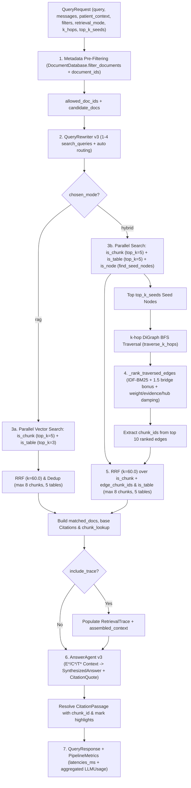

# Query & Retrieval Pipeline

`QueryPipeline` (`src/clinical_graph/pipelines/query.py`) orchestrates metadata pre-filtering, history-aware query rewriting and routing, `rag` or `hybrid` GraphRAG retrieval, edge ranking, Reciprocal Rank Fusion (RRF), strict evidence-grounded answer synthesis, and step-level observability.

## Pipeline Flowchart



---

## Stage-by-Stage Breakdown

### 1. Metadata Pre-Filtering (`DocumentDatabase`)

- **Implementation**: `QueryPipeline.run` (`src/clinical_graph/pipelines/query.py`), `DocumentDatabase.filter_documents` (`src/clinical_graph/graph/document_db.py`), `DocumentFilter` (`src/clinical_graph/schemas/document.py`), `QueryFilters` (`src/clinical_graph/schemas/query.py`).
- **Behavior**:
  - Builds a `DocumentFilter` from `payload.filters` (`doc_types`, `local_restrictions`, `conditions`, `target_populations`), with `status` defaulting to `DocumentStatus.ACTIVE`.
  - Queries SQLite via `DocumentDatabase.filter_documents(doc_filter)` using faceted `AND` semantics, then applies `payload.filters.document_ids` if provided.
  - Produces `candidate_docs` and `allowed_doc_ids: set[str]`, plus in-memory `chunk_index`, `table_index`, and `docs_by_id` lookup maps (`_build_chunk_and_table_indexes`).
- **Why pre-filtering**: Passing `allowed_doc_ids` into every vector search (`_search_vector_entries`) and graph traversal (`find_seed_nodes`, `traverse_k_hops`) prevents post-filtering from returning fewer than `k` results when restricted to a subset of documents.

### 2. History-Aware Query Rewriting & Routing (`QueryRewriter` `v3`)

- **Implementation**: `QueryRewriter.rewrite_with_routing_async` (`src/clinical_graph/agents/query_rewriter.py`), `src/clinical_graph/prompts/query_rewrite.yml` (`default_version: v3`).
- **Prompt Inputs**: Combines `request.messages` (conversation history), `request.patient_context` (`age_group`, `pregnancy_status`, `renal_impairment`, `allergies`), and `request.query`.
- **Structured Output (`RewrittenQueries`)**:
  - Calls `LiteLLMClient` at `temperature=0.0` to generate `1–4` short, standalone clinical search queries (`_dedup_queries(parsed.search_queries)[:4]`) suitable for both `is_chunk`/`is_table` vector search and `is_node` entity lookup.
  - Classifies `retrieval_mode` as `"rag"` (focused single-fact lookups such as dosing, screening intervals, or diagnostic thresholds) or `"hybrid"` (multi-entity interactions, contraindications across comorbidities, comparative therapies, or multi-step reasoning).
- **Routing Resolution & Fallback**:
  - If `QueryRequest.retrieval_mode` is `"rag"` or `"hybrid"`, that explicit choice overrides the rewriter.
  - When `QueryRequest.retrieval_mode == "auto"` (default), `chosen_mode` resolves to `"rag"` if `rewriter_mode in ("rag", "focused")`, otherwise `"hybrid"`.
  - If `llm_client is None` or rewriting fails, falls back safely to `([request.query], "hybrid", LLMUsage())`.

### 3. Retrieval Strategies (`rag` vs `hybrid`)

#### `rag` Mode
- Runs parallel `asyncio.to_thread` vector searches across all `search_queries`:
  - `is_chunk`: `_search_vector_entries(..., entry_types={"chunk"}, allowed_doc_ids=allowed_doc_ids, top_k=5)`
  - `is_table`: `_search_vector_entries(..., entry_types={"table"}, allowed_doc_ids=allowed_doc_ids, top_k=3)`
- Fuses per-query ranked ID lists using Reciprocal Rank Fusion (`_reciprocal_rank_fusion`, `k=60.0`, scoring `1 / (60 + rank)`).
- Resolves and deduplicates up to **8 chunks** (`retrieved_chunks`) and **5 tables** (`retrieved_tables`), collecting `matched_doc_ids`.

#### `hybrid` Mode
- Runs three sets of parallel `asyncio.to_thread` searches across all `search_queries`:
  - `is_chunk`: `entry_types={"chunk"}`, `top_k=5`
  - `is_table`: `entry_types={"table"}`, `top_k=5`
  - `is_node`: `KnowledgeManager` / `ClinicalKnowledgeGraph.find_seed_nodes(..., top_k=max(payload.top_k_seeds, 5), allowed_doc_ids=allowed_doc_ids)`
- **Seed Node Lookup (`find_seed_nodes`)** (`src/clinical_graph/graph/knowledge_graph.py`):
  1. **Vector-first**: Searches `is_node` embeddings (`top_k=max(top_k * 2, 10)`) restricted to `candidate_node_ids` matching `allowed_doc_ids`.
  2. **Exact full-query alias match**: Assigns score `1.0` for exact normalized alias matches.
  3. **Multi-word phrase alias match**: Matches multi-word aliases via word-boundary regex, scoring `min(0.95, 0.78 + 0.04 * len(words))`.
  4. **Token fallback**: Only when confident hits (`score >= 0.45`) are fewer than `top_k`, falls back to 1-word token alias lookup with score `0.50`.
  - Across all `search_queries`, seed scores are merged by maximum score and truncated to `[:payload.top_k_seeds]`.
- **$k$-Hop Graph Traversal (`traverse_k_hops`)**:
  - Performs BFS up to `payload.k_hops` (default `2`, range `1–10`) over both incoming and outgoing `DiGraph` edges whose `doc_ids` intersect `allowed_doc_ids`, returning `(traversed_edges, matched_doc_ids)`.

### 4. Edge Ranking (`_rank_traversed_edges`)

- **Implementation**: `_rank_traversed_edges` (`src/clinical_graph/pipelines/query.py`).
- **Filtering**: Excludes self-loops (`edge.get("source") != edge.get("target")`).
- **Lexical Relevance (IDF-weighted BM25)**:
  - Tokenizes `[query, *search_queries]` and builds a document per edge from `f"{u} {rel} {v} {rel_desc} {excerpts_text}"`.
  - Computes BM25 with `k1 = 1.5` and `b = 0.75` and corpus IDF `log(1.0 + (num_docs - df + 0.5) / (df + 0.5))`.
- **Multi-Seed Bridge Bonus**:
  - Adds `+1.5` to `bm25` if both endpoints `u` and `v` are in `seed_nodes` (`u in seed_scores and v in seed_scores`).
  - Edges with `bm25 <= 0.0` score `0.0`.
- **Structural & Evidence Scaling**:
  - Final score:
    ```text
    bm25 * (0.5 + 0.05 * weight) * log1p(max(1, len(evidence))) * hub_damping
    ```
  - Where `hub_damping = 1.0 / sqrt(max(1, deg_u * deg_v))` with `deg_u = max(1, graph.degree(u))` and `deg_v = max(1, graph.degree(v))`, down-weighting high-degree hub nodes.

### 5. Chunk Deduplication & RRF Fusion

- In `hybrid` mode, `QueryPipeline.run` extracts `chunk_id`s from the **top 10 ranked edges** (`ranked_edges[:10]`) into `edge_chunk_ids` and appends that list to the `is_chunk` vector hit lists as input to `_reciprocal_rank_fusion(..., k=60.0)`.
- Fused chunk IDs are resolved via `_resolve_chunk_entry` (reading from `vector_store` or slicing `cleaned` / `doc.content` via `ChunkSpan`), deduplicated by `chunk_id`, and capped at **8 chunks**.
- `is_table` hits are fused via `_reciprocal_rank_fusion`, resolved via `_resolve_table_entry`, deduplicated by `table_id`, and capped at **5 tables**.
- Builds `matched_docs`, base `Citation` objects (`_build_doc_citation_evidence`), and `chunk_lookup: dict[str, str]` mapping each `chunk_id` to its full chunk text for downstream citation highlighting.

### 6. Context Assembly, Strict Synthesis & Highlighted Citations (`AnswerAgent` `v3`)

- **Implementation**: `AnswerAgent` (`src/clinical_graph/agents/answer_agent.py`), `src/clinical_graph/prompts/answer_synthesis.yml` (`default_version: v3`).
- **Ref-Tagged Context Assembly (`_build_context_sections_with_refs`)**:
  - Assembles `Query`, `Patient context` (if present), `Matched concepts`, `Graph evidence` (top `25` ranked edges tagged `[E1]..[E25]`), `Retrieved chunks` (`[C1]..[C8]`), `Retrieved tables` (`[T1]..[T5]`), and `Supporting sources`, while building `ref_map` (`ref_id -> {doc_id, chunk_id, text}`).
- **Strict No-Pretraining Synthesis**:
  - Calls `LiteLLMClient` at `temperature=0.0` with `response_format=SynthesizedAnswer` (`answer: str`, `citations: list[CitationQuote(ref_id, quote)]`).
  - `v3` prompt forbids relying on pretraining or outside medical knowledge: every dose, threshold, target range, contraindication, and claim must be grounded in the provided context, with verbatim quotes referencing `[E*]`, `[C*]`, or `[T*]`.
  - Falls back to deterministic context-grounded output (`synthesize`) when `llm_client is None` or no context was retrieved (`_empty_response`).
- **Highlighted Citations (`_rebuild_citations` & `_highlight_quote_in_text`)**:
  - Resolves each `CitationQuote(ref_id, quote)` against `ref_map` into a `CitationPassage(chunk_id, quote, chunk_text, highlighted_chunk, match_start, match_end)` grouped by `doc_id`.
  - Highlighting strategy in `_highlight_quote_in_text`:
    1. **Whitespace/hyphen-tolerant regex**: Matches tokens joined by `(?:-\s+|\s+)` (case-insensitive) and wraps the span in `<mark>...</mark>`.
    2. **PDF line-break de-hyphenation**: If `"-\n"` is present in `source_text`, strips `"-\n"` plus leading indentation while tracking original character offsets (`orig_offsets`), re-runs the regex, and maps `[start, end]` back to `source_text`.
    3. **BM25 sentence/line fallback**: Splits `source_text` into sentences via `_SENTENCE_SPLIT_RE` (or lines if none) and selects the highest-scoring BM25 segment (`k1=1.5`, `b=0.75`) to wrap in `<mark>...</mark>`.

### 7. Observability (`PipelineMetrics` & `RetrievalTrace`)

- **Implementation**: `PipelineMetrics` & `LLMUsage` (`src/clinical_graph/schemas/metrics.py`), `RetrievalTrace` (`src/clinical_graph/schemas/query.py`), `extract_usage` (`src/clinical_graph/llm/client.py`).
- **`PipelineMetrics`** (always returned on `QueryResponse.metrics`):
  - `latencies_ms`: Step-level wall-clock timings in milliseconds:
    - `filter_documents`
    - `query_rewrite`
    - `rag_retrieval` (in `rag` mode) or `seed_search` + `k_hop_traversal` (in `hybrid` mode)
    - `answer_synthesis`
    - `total`
  - `usage`: Aggregated `LLMUsage` (`rewrite_usage.add(answer_usage)`) summing `prompt_tokens`, `completion_tokens`, `total_tokens`, and `estimated_cost_usd` (computed via `litellm.completion_cost`).
- **`RetrievalTrace`** (populated on `QueryResponse.trace` when `QueryRequest.include_trace=True`):
  - Captures `search_queries`, `retrieval_mode`, `requested_mode`, `chosen_mode`, `seed_nodes`, `traversed_edges` (ranked), `matched_doc_ids`, and `assembled_context`.
