# Query & Retrieval Pipeline

`QueryPipeline` (`src/clinical_graph/pipelines/query.py`) orchestrates metadata pre-filtering, history-aware query rewriting and routing, `rag` or `hybrid` GraphRAG retrieval, edge ranking, Reciprocal Rank Fusion (RRF), strict evidence-grounded answer synthesis, and step-level observability.

## Pipeline Flowchart

```mermaid
flowchart TD
    Req["QueryRequest (query, messages, patient_context, filters, retrieval_mode, k_hops, top_k_seeds)"] --> Guard["0. ClinicalGuardClient.check_prompt (Regex + clinical-guard)"]
    Guard -- "Blocked" --> BlockedResp["Early Refusal (guard_blocked=true)"]
    Guard -- "Allowed" --> Filter["1. Metadata Pre-Filtering (DocumentDatabase.filter_documents + document_ids)"]
    Filter --> Allowed["allowed_doc_ids + candidate_docs"]
    Allowed --> Rewrite["2. QueryRewriter v4 (1-4 search_queries + auto routing + is_medical gate)"]
    Rewrite -- "is_medical=false" --> OffTopicResp["Early Off-Topic Refusal"]
    Rewrite -- "is_medical=true" --> BatchEmbed["Single-Batch Query Embedding (vector_store.embed_queries)"]
    BatchEmbed --> LabelGate{"Trigger 1: node_label >= 0.48?"}
    LabelGate -- "No (web_fallback=true)" --> ParallelWeb["Parallel 1-Shot Web Search (Tavily + Vector Chunk RAG + Guard)"]
    LabelGate -- "Yes" --> Mode{"chosen_mode?"}
    ParallelWeb --> Mode

    Mode -- "rag" --> RagSearch["3a. Parallel Vector Search: is_chunk (top_k=5) + is_table (top_k=3)"]
    RagSearch --> RagRRF["RRF (k=60.0) & Dedup (max 8 chunks, 5 tables, chunk_sources=rag)"]

    Mode -- "hybrid" --> HybSearch["3b. Parallel Search: is_chunk (top_k=5) + is_table (top_k=5) + is_node (find_seed_nodes)"]
    HybSearch --> Seeds["Top top_k_seeds Seed Nodes"]
    Seeds --> Traverse["k-hop DiGraph BFS Traversal (hop-tagged traverse_k_hops)"]
    Traverse --> RankEdges["4. _rank_traversed_edges (IDF-BM25 + 1.5 bridge bonus + weight/evidence/hub damping + hop_decay)"]
    RankEdges --> HybAssemble["5. Elastic 2-Channel Assembly: up to 6 RAG RRF + 1/qualifying edge (max 12) + RAG backfill (min 8) + chunk_sources"]
    HybSearch --> HybAssemble

    RagRRF --> Evidence["Build matched_docs, base Citations & chunk_lookup"]
    HybAssemble --> Evidence
    Evidence --> WebCheck{"Trigger 2: web_fallback=true &amp; not ParallelWeb?"}
    WebCheck -- "Yes" --> Decision["OpenAIDecisionClient (gpt-6-luna)"]
    Decision -- "Insufficient" --> SeqWeb["1-Shot Web Search (Tavily + Vector Chunk RAG + Guard)"]
    Decision -- "Sufficient" --> Trace
    SeqWeb --> Trace
    WebCheck -- "No" --> Trace{"include_trace?"}
    ParallelWeb --> Synth
    Trace -- "Yes" --> BuildTrace["Populate RetrievalTrace + assembled_context"]
    Trace -- "No" --> Synth
    BuildTrace --> Synth["6. AnswerAgent v4 (&lt;source_data&gt; E*/C*/T*/W* Context -> SynthesizedAnswer + CitationQuote)"]
    Synth --> Highlight["Resolve CitationPassage with chunk_id & mark highlights"]
    Highlight --> Resp["7. QueryResponse + PipelineMetrics (latencies_ms + aggregated LLMUsage)"]
```



---

## Stage-by-Stage Breakdown

### 0. Prompt-Injection Guardrail Pre-Check (`ClinicalGuardClient`)

- **Implementation**: `ClinicalGuardClient.check_prompt` (`src/clinical_graph/guardrails/prompt_guard.py`), invoked at the start of `QueryPipeline.run` (`src/clinical_graph/pipelines/query.py`).
- **Behavior**:
  - Runs local deterministic regex & zero-width/bidi character smuggling rules (`scan_text_for_injection`) first.
  - If not flagged locally, calls `POST {clinical_guard_url}/v1/guard/prompt` with `X-Forwarded-For` client IP forwarding and up to 3 attempts with `Retry-After` backoff on `429`/`503`.
  - If blocked, returns an early `QueryResponse` with `guard_blocked=True` and `latencies_ms["guard"]`.
  - **Web fallback independence**: Web fallback (`allow_web_fallback`) does not require `clinical-guard` to be reachable; instead, enabling it in the UI requires explicit user confirmation and retrieved passages are guarded via local `scan_text_for_injection` + `<source_data>` delimiters.

### 1. Metadata Pre-Filtering (`DocumentDatabase`)

- **Implementation**: `QueryPipeline.run` (`src/clinical_graph/pipelines/query.py`), `DocumentDatabase.filter_documents` (`src/clinical_graph/graph/document_db.py`), `DocumentFilter` (`src/clinical_graph/schemas/document.py`), `QueryFilters` (`src/clinical_graph/schemas/query.py`).
- **Behavior**:
  - Builds a `DocumentFilter` from `payload.filters` (`doc_types`, `local_restrictions`, `conditions`, `target_populations`), with `status` defaulting to `DocumentStatus.ACTIVE`.
  - Queries SQLite via `DocumentDatabase.filter_documents(doc_filter)` using faceted `AND` semantics, then applies `payload.filters.document_ids` if provided.
  - Produces `candidate_docs` and `allowed_doc_ids: set[str]`, plus in-memory `chunk_index`, `table_index`, and `docs_by_id` lookup maps (`_build_chunk_and_table_indexes`).
- **Why pre-filtering**: Passing `allowed_doc_ids` into every vector search (`_search_vector_entries`) and graph traversal (`find_seed_nodes`, `traverse_k_hops`) prevents post-filtering from returning fewer than `k` results when restricted to a subset of documents.

### 2. History-Aware Query Rewriting, Routing & `is_medical` Gate (`QueryRewriter` `v4`)

- **Implementation**: `QueryRewriter.rewrite_with_gate_async` (`src/clinical_graph/agents/query_rewriter.py`), `src/clinical_graph/prompts/query_rewrite.yml` (`default_version: v4`).
- **Prompt Inputs**: Combines `request.messages` (conversation history), `request.patient_context` (`age_group`, `pregnancy_status`, `renal_impairment`, `allergies`), and `request.query`.
- **Structured Output (`RewrittenQueries`)**:
  - Calls `LiteLLMClient` at `temperature=0.0` to generate `1–4` short, standalone clinical search queries (`_dedup_queries(parsed.search_queries)[:4]`) suitable for both `is_chunk`/`is_table` vector search and `is_node` entity lookup.
  - Classifies `retrieval_mode` as `"rag"` (focused single-fact lookups such as dosing, screening intervals, or diagnostic thresholds) or `"hybrid"` (multi-entity interactions, contraindications across comorbidities, comparative therapies, or multi-step reasoning).
  - Sets `is_medical: bool` (and `off_topic_reason: str | None` when `false`): if `is_medical=False`, `QueryPipeline.run` returns an early refusal `QueryResponse` without running retrieval or synthesis.
- **Routing Resolution & Fallback**:
  - If `QueryRequest.retrieval_mode` is `"rag"` or `"hybrid"`, that explicit choice overrides the rewriter.
  - When `QueryRequest.retrieval_mode == "auto"` (default), `chosen_mode` resolves to `"rag"` if `rewriter_mode in ("rag", "focused")`, otherwise `"hybrid"`.
  - If `llm_client is None` or rewriting fails, falls back safely to `([request.query], "hybrid", True, None, LLMUsage())`.

### 3. Single-Batch Query Embedding & Retrieval Strategies (`rag` vs `hybrid`)

- **Single-Batch Query Embedding Reuse**: Before dispatching retrieval, `QueryPipeline.run` calls `vector_store.embed_queries(search_queries, api_key=api_key)` once and passes the precomputed `query_vector` into `_search_vector_entries` (`is_chunk` and `is_table`) and `find_seed_nodes` (`is_node`), avoiding redundant embedding API calls.

#### `rag` Mode
- Runs parallel `asyncio.to_thread` vector searches across all `search_queries`:
  - `is_chunk`: `_search_vector_entries(..., entry_types={"chunk"}, allowed_doc_ids=allowed_doc_ids, top_k=5, query_vector=...)`
  - `is_table`: `_search_vector_entries(..., entry_types={"table"}, allowed_doc_ids=allowed_doc_ids, top_k=3, query_vector=...)`
- Fuses per-query ranked ID lists using Reciprocal Rank Fusion (`_reciprocal_rank_fusion`, `k=60.0`, scoring `1 / (60 + rank)`).
- Resolves and deduplicates up to **8 chunks** (`retrieved_chunks`, each tagged `"rag"` in `chunk_sources`) and **5 tables** (`retrieved_tables`), collecting `matched_doc_ids`.

#### `hybrid` Mode
- Runs three sets of parallel `asyncio.to_thread` searches across all `search_queries` (reusing the precomputed `query_vector`s):
  - `is_chunk`: `entry_types={"chunk"}`, `top_k=5`
  - `is_table`: `entry_types={"table"}`, `top_k=5`
  - `is_node`: `KnowledgeManager` / `ClinicalKnowledgeGraph.find_seed_nodes(..., top_k=max(payload.top_k_seeds, 5), allowed_doc_ids=allowed_doc_ids, query_vector=...)`
- **Seed Node Lookup (`find_seed_nodes`)** (`src/clinical_graph/graph/knowledge_graph.py`):
  1. **Vector-first**: Searches `is_node` embeddings (`top_k=max(top_k * 2, 10)`) restricted to `candidate_node_ids` matching `allowed_doc_ids`.
  2. **Exact full-query alias match**: Assigns score `1.0` for exact normalized alias matches.
  3. **Multi-word phrase alias match**: Matches multi-word aliases via word-boundary regex, scoring `min(0.95, 0.78 + 0.04 * len(words))`.
  4. **Token fallback**: Only when confident hits (`score >= 0.45`) are fewer than `top_k`, falls back to 1-word token alias lookup with score `0.50`.
  - Across all `search_queries`, seed scores are merged by maximum score and truncated to `[:payload.top_k_seeds]`.
- **Hop-Tagged $k$-Hop Graph Traversal (`traverse_k_hops`)**:
  - Performs BFS up to `payload.k_hops` (default `2`, range `1–10`) over both incoming and outgoing `DiGraph` edges whose `doc_ids` intersect `allowed_doc_ids`, tagging each returned edge with its discovery `"hop": depth + 1` and returning `(traversed_edges, matched_doc_ids)`.

### 4. Edge Ranking (`_rank_traversed_edges`)

- **Implementation**: `_rank_traversed_edges` (`src/clinical_graph/pipelines/query.py`).
- **Filtering**: Excludes self-loops (`edge.get("source") != edge.get("target")`).
- **Lexical Relevance (IDF-weighted BM25)**:
  - Tokenizes `[query, *search_queries]` and builds a document per edge from `f"{u} {rel} {v} {rel_desc} {excerpts_text}"`.
  - Computes BM25 with `k1 = 1.5` and `b = 0.75` and corpus IDF `log(1.0 + (num_docs - df + 0.5) / (df + 0.5))`.
- **Multi-Seed Bridge Bonus**:
  - Adds `+1.5` to `bm25` if both endpoints `u` and `v` are in `seed_nodes` (`u in seed_scores and v in seed_scores`).
  - Edges with `bm25 <= 0.0` score `0.0`.
- **Structural, Evidence & Hop-Decay Scaling**:
  - Final score:
    ```text
    bm25 * (0.5 + 0.05 * weight) * log1p(max(1, len(evidence))) * hub_damping * hop_decay
    ```
  - Where `hub_damping = 1.0 / sqrt(max(1, deg_u * deg_v))` (`deg_u = max(1, graph.degree(u))`, `deg_v = max(1, graph.degree(v))`) down-weights high-degree hub nodes, and `hop_decay = 1.0 / (1.0 + 0.35 * (hop - 1))` prioritizes direct 1-hop edges over deeper hops.
  - Qualifying edges are selected where `score > 0.0 and score >= 0.35 * top_edge_score` (capped at `20` edges), falling back to the top `10` positive-scoring edges if none qualify.

### 5. Elastic Two-Channel Chunk Assembly & `chunk_sources`

- In `hybrid` mode, `QueryPipeline.run` fuses `is_chunk` vector hits via `_reciprocal_rank_fusion(..., k=60.0)` and assembles `retrieved_chunks` across two channels:
  1. **Channel 1 (Core RAG)**: Resolves up to **6** top-ranked RRF chunks first.
  2. **Channel 2 (Graph Evidence)**: Iterates over `qualifying_edges`, adding at most **1** novel evidence `chunk_id` per qualifying edge up to **12 total chunks**.
  3. **RAG Backfill**: If total chunks are still below **8**, backfills from the remaining `fused_chunk_ids` until at least **8 chunks** are present (when available).
- Each resolved chunk is tagged in `chunk_sources: dict[str, Literal["rag", "graph", "both"]]` based on whether its `chunk_id` appeared in `rag_candidate_ids` (RRF vector hits), `graph_candidate_ids` (evidence from `ranked_edges`), or `"both"`.
- `is_table` hits are fused via `_reciprocal_rank_fusion`, resolved via `_resolve_table_entry`, deduplicated by `table_id`, and capped at **5 tables**.
- Builds `matched_docs`, base `Citation` objects (`_build_doc_citation_evidence`), and `chunk_lookup: dict[str, str]` mapping each `chunk_id` to its full chunk text for downstream citation highlighting.

### 6. Context Assembly, Strict Synthesis & Highlighted Citations (`AnswerAgent` `v4`)

- **Implementation**: `AnswerAgent` (`src/clinical_graph/agents/answer_agent.py`), `src/clinical_graph/prompts/answer_synthesis.yml` (`default_version: v4`).
- **Ref-Tagged Context Structure (`_build_context_sections_with_refs`)**:
  - Assembles sections in a fixed order separated by blank lines (`\n\n`), while building `ref_map` (`ref_id -> {doc_id, chunk_id, text}`):
    1. `Query: <user query>`
    2. `Patient context: ...` *(if `patient_context` is provided)*
    3. `Matched concepts:` *(seed nodes with `[node_type]`, similarity score, and description)*
    4. `Graph evidence:` *(top ranked edges tagged `[E1]..[E25]`, cross-referencing `[source: C*]` when the edge's chunk is already in `Retrieved chunks`, or inline excerpts otherwise)*
    5. `Retrieved chunks:` *(deduplicated text passages tagged `[C1]..[C12]`, formatted `- [C1] [<slug>] (<chunk_id>): <text>`)*
    6. `Retrieved tables:` *(summarized/markdown tables tagged `[T1]..[T5]`)*
    7. `Supporting sources:` *(document titles, slugs, and `doc_type`s)*
  - **Example prompt context**:
    ```text
    Query: What is the initial starting dose of metformin?

    Matched concepts:
    - Metformin [drug] (0.91): First-line oral biguanide for Type 2 diabetes.

    Graph evidence:
    - [E1] metformin --[contraindicated_in]--> severe_renal_impairment (Contraindicated at eGFR < 30 mL/min/1.73 m²) [source: C2]

    Retrieved chunks:
    - [C1] [metformin-label] (doc_5bb6462e4809:chunk:11): - The recommended starting dose of GLUCOPHAGE is 500 mg orally twice a day...
    - [C2] [metformin-label] (doc_5bb6462e4809:chunk:44): GLUCOPHAGE is contraindicated in patients with an eGFR below 30 mL/min/1.73 m².

    Retrieved tables:
    - [T1] [metformin-label] (doc_5bb6462e4809:table:1):
    | Regimen | Starting Dose | Max Dose |
    | ... |

    Supporting sources:
    - [metformin-label] Metformin Label (fda_label)
    ```
  - **Rationale**:
    - **Structured map first, verbatim evidence second:** Putting `Matched concepts` and `Graph evidence` before `Retrieved chunks` gives the model a compact relational overview of entities and cross-document links, while keeping the full verbatim `[C*]`/`[T*]` passages cleanly separated for exact quoting.
    - **Deduplicated cross-referencing (`[source: C*]`):** When an edge's supporting chunk is already in `Retrieved chunks`, `Graph evidence` emits `[source: C2]` instead of repeating the excerpt, avoiding duplicate tokens.
    - **Strict citation anchoring (`[C*]`/`[T*]` only):** `v4` instructs the model to write clean prose in `"answer"` (without inline `[C1]`/`[E1]` tags) and place verbatim quotes in `"citations"` referencing only `[C*]` or `[T*]` (never `[E*]`), guaranteeing every citation resolves to a real `chunk_id` and source document.
- **Strict No-Pretraining Synthesis**:
  - Calls `LiteLLMClient` at `temperature=0.0` with `response_format=SynthesizedAnswer` (`answer: str`, `citations: list[CitationQuote(ref_id, quote)]`).
  - Falls back to deterministic context-grounded output (`synthesize`) when `llm_client is None` or no context was retrieved (`_empty_response`).
- **Highlighted Citations (`_rebuild_citations` & `_highlight_quote_in_text`)**:
  - Resolves each `CitationQuote(ref_id, quote)` against `ref_map` into a `CitationPassage(chunk_id, quote, chunk_text, highlighted_chunk, match_start, match_end)` grouped by `doc_id`.
  - Highlighting strategy in `_highlight_quote_in_text`:
    1. **Whitespace/hyphen-tolerant regex**: Matches tokens joined by `(?:-\s+|\s+)` (case-insensitive) and wraps the span in `<mark>...</mark>`.
    2. **Offset-mapped markdown/bullet/pipe/de-hyphenation pass**: Strips `-\n`, markdown emphasis (`**`, `__`, `` ` ``), heading/bullet prefixes, and table pipes (`|`) while tracking exact character offsets back to `source_text`.
    3. **BM25 sentence/line fallback**: Splits `source_text` into sentences via `_SENTENCE_SPLIT_RE` (or lines if none) and selects the highest-scoring BM25 segment (`k1=1.5`, `b=0.75`) to wrap in `<mark>...</mark>`.

### 7. Observability (`PipelineMetrics` & `RetrievalTrace`)

- **Implementation**: `PipelineMetrics` & `LLMUsage` (`src/clinical_graph/schemas/metrics.py`), `RetrievalTrace` (`src/clinical_graph/schemas/query.py`), `extract_usage` (`src/clinical_graph/llm/client.py`).
- **`PipelineMetrics`** (always returned on `QueryResponse.metrics`):
  - `latencies_ms`: Step-level wall-clock timings in milliseconds:
    - `filter_documents`
    - `query_rewrite`
    - `rag_retrieval` (in `rag` mode) or `seed_search` + `k_hop_traversal` (in `hybrid` mode)
    - `answer_synthesis`
    - `total`
  - `usage`: Aggregated `LLMUsage` (`rewrite_usage.add(answer_usage)`) summing `prompt_tokens`, `completion_tokens`, `total_tokens`, and `estimated_cost_usd` (computed via `litellm.completion_cost`).
- **`RetrievalTrace`** (populated on `QueryResponse.trace` when `QueryRequest.include_trace=True`):
  - Captures `search_queries`, `retrieval_mode`, `requested_mode`, `chosen_mode`, `seed_nodes`, `traversed_edges` (ranked), `matched_doc_ids`, `chunk_sources` (`"rag"`, `"graph"`, or `"both"` per `chunk_id`), and `assembled_context`.
