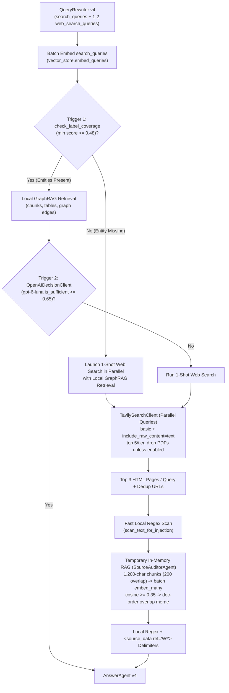

# Verified Web Fallback Search

`clinical-graph` includes an optional, allowlist-enforced 1-shot web fallback pipeline (`src/clinical_graph/search/`) that augments local GraphRAG retrieval when local documents and graph edges are insufficient to answer a clinical query.

---

## 1. Architecture & Data Flow

---

## 2. Configuration

Set the following environment variables (or `CLINICAL_GRAPH_*` equivalents) in `.env`:

| Variable | Description | Default |
| :--- | :--- | :--- |
| `ENABLE_WEB_FALLBACK` | Global flag enabling web fallback when `allow_web_fallback` is not overridden per request. | `false` |
| `TAVILY_API_KEY` | Tavily Search API key (`include_domains` is configured automatically from `allowlist.py`). | `None` |
| `DECISION_MODEL` | OpenAI Decisions API model for Trigger 2 sufficiency checks. | `gpt-6-luna` |
| `WEB_LABEL_SIMILARITY_THRESHOLD` | Minimum cosine similarity against `label_vectors.npz` before Trigger 1 fires. | `0.48` |
| `ENABLE_WEB_PDF_FETCH` | Allow fetching and parsing `.pdf` URLs (via PyMuPDF in worker threads) instead of HTML-only. | `false` |
| `INCLUDE_REGIONAL_DOMAINS` | Also query `REGIONAL_DOMAINS` (India, China, PDF-heavy EU/CA/AU bodies) in parallel. | `false` |
| `WEB_SEARCH_RESULTS_PER_TIER` | Tavily `max_results` per tier when `ENABLE_WEB_PDF_FETCH=false`. | `5` |
| `WEB_SEARCH_RESULTS_PER_TIER_WITH_PDF` | Tavily `max_results` per tier when `ENABLE_WEB_PDF_FETCH=true`. | `3` |
| `WEB_FETCH_TIMEOUT_SECONDS` | Fallback HTTP fetch timeout when Tavily `raw_content` is unavailable or PDF is enabled. | `8.0` |

Per-request control is also available via `QueryRequest.allow_web_fallback` (`true`, `false`, or `null` to inherit `ENABLE_WEB_FALLBACK`). In the web UI, toggling **Web Search** ON displays an explicit confirmation modal noting that external allowlisted pages are screened with local pattern checks and `<source_data>` delimiters rather than the ML `clinical-guard` model.

---

## 3. Temporary In-Memory RAG & Prompt-Injection Guarding

1. **Zero Extra Query Embeddings:** `SourceAuditorAgent.audit_pages_batch` reuses the `search_queries` embeddings already computed by `QueryPipeline`.
2. **Regex Pre-Screen:** Every page passes `scan_text_for_injection` (regex + zero-width/bidi character detection) before chunking.
3. **Chunking & Vector Selection:** Clean pages are split into `1,200`-character overlapping chunks (`200`-char overlap, snapped to word boundaries), embedded in one batch (`embed_many`), and filtered by cosine similarity (`>= 0.35`, max `6` chunks total, max `3` per page).
4. **Document-Order Overlap Reassembly:** Selected spans for each page are sorted by `start_char` and merged (`merge_selected_chunks`) so overlapping passages are returned as coherent text without duplication.
5. **Post-Retrieval Screening & Delimiting:** `scan_text_for_injection` re-checks merged chunks (`< 1 ms`), and `AnswerAgent` wraps them in `<source_data ref="W*">` delimiters (strictly untrusted reference data). Only web sources cited by `AnswerAgent` in `web_citations` are returned in `QueryResponse.web_sources`.

---

## 4. Verified Website Allowlist

Allowlist enforcement is applied in **two layers**: via Tavily's `include_domains` (`include_domains_mode="restrict"`) and in Python (`src/clinical_graph/search/allowlist.py`) across both initial URLs and HTTP redirects.

### Default Western / Global Tier (`DOMINANT_DOMAINS`)
- **Global:** `who.int`, `pubmed.ncbi.nlm.nih.gov`, `pmc.ncbi.nlm.nih.gov`, `ncbi.nlm.nih.gov`, `merckmanuals.com`, `msdmanuals.com`
- **United States:** `nih.gov`, `medlineplus.gov`, `cdc.gov`, `fda.gov`, `dailymed.nlm.nih.gov`, `open.fda.gov`, `mayoclinic.org`, `my.clevelandclinic.org`, `hopkinsmedicine.org`
- **United Kingdom:** `nhs.uk`, `nice.org.uk`
- **Western EU / CA / AU:** `ema.europa.eu`, `ecdc.europa.eu`, `canada.ca`, `healthdirect.gov.au`

### Optional Regional Tier (`REGIONAL_DOMAINS`, enabled via `INCLUDE_REGIONAL_DOMAINS=true`)
- **Specialized Global:** `clinicaltrials.gov`, `orpha.net`
- **UK Regulatory:** `gov.uk`, `products.mhra.gov.uk` *(Geo-blocked `bnf.nice.org.uk` and `cks.nice.org.uk` are excluded.)*
- **EU / CA / AU (PDF-heavy):** `register.awmf.org`, `awmf.org`, `rki.de`, `has-sante.fr`, `cda-amc.ca`, `tga.gov.au`, `safetyandquality.gov.au`, `australianprescriber.tg.org.au`
- **India:** `icmr.gov.in`, `ncdirindia.org`, `mohfw.gov.in`, `nhsrcindia.org`, `cdsco.gov.in`, `aiims.edu`, `newbornwhocc.org`, `nhp.gov.in`, `janaushadhi.gov.in`
- **China:** `nhc.gov.cn`, `nmpa.gov.cn`, `chinacdc.cn`, `cma.org.cn`, `guidelines-registry.org`, `cpa.org.cn`

---

## 5. Frontend Integration

In `frontend/index.html` and `frontend/app.js`, the pipeline bar includes a **Web Search** stage (`#stage-web-search`):
- **Disabled:** Displayed greyed out (`.pipeline-stage.disabled`) with `Disabled`.
- **Enabled:** Animates during web retrieval and renders compact file icons (`.evidence-file-icon`) for each injected HTML page or PDF. Hovering displays the source title and URL; clicking opens the verified URL in a new tab.
